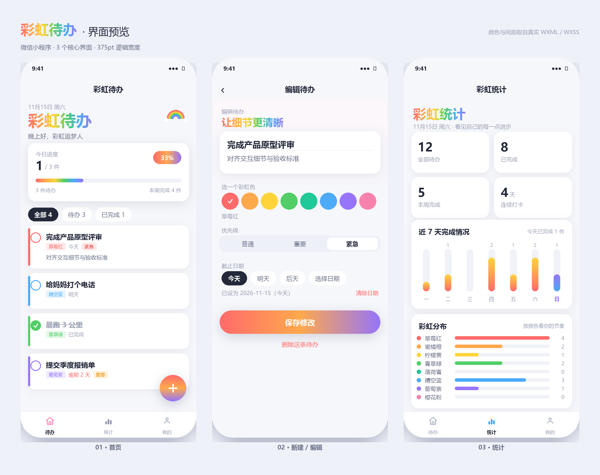

# 彩虹待办 · Rainbow ToDo

> 用彩虹色给生活分类，用勾选记录进步。

一个原生微信小程序待办应用。无需 npm、无云开发依赖，导入微信开发者工具即可运行。

## 项目简介

彩虹待办是一个「轻、快、好看」的本地待办小程序：

- 用 8 种彩虹色为不同领域（工作、生活、健康、学习……）做视觉分类；
- 用「今日进度」把每天的完成量变成看得见的彩虹条；
- 用「统计」页记录连续打卡、近 7 天完成趋势和颜色分布；
- 数据只保存在本机微信 Storage 中，可随时导出 JSON、清理或重置。

设计目标：打开 3 秒内能完成一次记录，勾选时有即时反馈，长期使用不产生负担。

## 核心功能

| 模块 | 能力 |
| --- | --- |
| 待办首页 | 今日进度、全部 / 待办 / 已完成筛选、任务卡片、浮动新增按钮 |
| 新建 / 编辑 | 标题、备注、颜色、优先级、截止日期（今天 / 明天 / 后天 / 自定义） |
| 任务操作 | 点击圆圈完成、长按唤起「完成 / 编辑 / 删除」操作面板 |
| 逾期提醒 | 过期未完成显示「逾期 N 天」并标红 |
| 统计 | 全部、已完成、本周完成、连续打卡、近 7 天柱状图、彩虹分布 |
| 我的 | 昵称、每日目标（1–10）、完成震动开关、清理已完成、导出数据、清空重置 |
| 空状态 | 针对「全部 / 待办 / 已完成」三种筛选给出不同文案 |

## 快速开始

1. 打开微信开发者工具，选择「导入项目」。
2. 项目目录选择本仓库根目录。
3. AppID 选择「测试号」，或填入自己的 AppID（<code>project.config.json</code> 中默认为 <code>touristappid</code>）。
4. 点击编译即可在模拟器中预览，也可扫码真机预览。

无需执行安装命令，也无需配置服务器域名。

## 目录结构

    Rainbow-ToDo/
    ├── app.js                    小程序入口，预热本地存储
    ├── app.json                  页面注册、窗口样式、tabBar 配置
    ├── app.wxss                  全局设计变量与通用样式
    ├── project.config.json       开发者工具项目配置
    ├── sitemap.json              索引配置
    ├── pages/
    │   ├── index/                待办首页（进度、筛选、任务列表）
    │   ├── editor/               新建 / 编辑待办
    │   ├── stats/                统计页
    │   └── mine/                 我的 / 设置
    ├── utils/
    │   ├── date.js               日期计算、相对日期文案、问候语
    │   ├── colors.js             彩虹调色板、颜色名、透明度转换
    │   ├── store.js              任务与设置的数据层（Storage）
    │   ├── format.js             任务视图模型
    │   ├── tasks.js              排序、筛选、计数
    │   └── stats.js              进度、连续打卡、周趋势、颜色分布
    ├── images/                   tabBar 图标（81×81 PNG）
    ├── test/                     单元测试、页面集成测试、静态检查
    ├── tools/                    图标生成、设计图渲染脚本
    ├── docs/设计说明.md           产品与视觉设计说明
    └── preview/                  界面预览图与 HTML 设计板

## 数据模型

任务对象保存在 <code>rainbow_tasks_v1</code>：

    {
      "id": "t...",
      "title": "完成产品原型评审",
      "note": "对齐交互细节与验收标准",
      "color": "#FF6B6B",
      "priority": 2,
      "dueDate": "2026-11-15",
      "done": false,
      "createdAt": 1763193600000,
      "updatedAt": 1763193600000,
      "doneAt": null
    }

- <code>priority</code>：0 普通、1 重要、2 紧急。
- <code>dueDate</code>：<code>YYYY-MM-DD</code>，空字符串表示无截止日期。
- <code>doneAt</code>：完成时间戳，用于「今日进度」「本周完成」「连续打卡」。
- 设置保存在 <code>rainbow_settings_v1</code>：昵称、每日目标、震动开关。

数据层做了防御性处理：过滤脏数据、去重 id、字段归一化，存储损坏时回落到空列表。

## 统计口径

- **今日进度**：今天完成的任务数 ÷ 每日目标，最高 100%。
- **本周完成**：近 7 天（含今天）每天完成数之和。
- **连续打卡**：从今天（或昨天）向前连续有完成记录的天数；断档即归零。
- **彩虹分布**：按 8 种彩虹色统计任务数量，并以最大值为 100% 归一化。

## 本地校验

在仓库根目录执行：

    node test/unit-tests.js
    node test/page-tests.js
    node test/check-project.js

- <code>unit-tests.js</code>：日期、颜色、存储、排序、统计等纯逻辑。
- <code>page-tests.js</code>：用 mock 的 <code>wx</code> 与 <code>Page</code> 驱动四个页面的生命周期与事件。
- <code>check-project.js</code>：JSON 合法性、页面文件完整性、JS 语法、WXSS 花括号、WXML 标签配平、事件处理函数存在性、图标尺寸与体积。

重新生成 tabBar 图标（需要 Pillow）：

    python tools/gen_icons.py

重新生成设计预览图（需要 Pillow + 微软雅黑）：

    python tools/render_preview.py

## 视觉与设计

- **主色**：草莓红 <code>#FF6B6B</code>、蜜橘橙 <code>#FFA94D</code>、柠檬黄 <code>#FFD43B</code>、青草绿 <code>#51CF66</code>、薄荷青 <code>#20C997</code>、晴空蓝 <code>#4DABF7</code>、葡萄紫 <code>#9775FA</code>、樱花粉 <code>#F783AC</code>。
- **背景**：<code>#F6F7FB</code> 冷调浅灰，衬托白卡片与彩色标签。
- **圆角**：卡片 32rpx、按钮胶囊形、色块圆形。
- **阴影**：低透明度冷色阴影，避免脏边。
- **动效**：列表逐项上浮、悬浮按钮按压缩放、吉祥物轻轻摆动。

更多设计决策见 [设计说明](docs/设计说明.md)。

## 隐私

所有数据仅写入本机微信 Storage，不上传、不联网、不申请任何用户信息权限。

## 已知限制

- 当前环境未安装微信开发者工具，界面渲染以 WXML / WXSS 静态校验、页面逻辑集成测试和设计图还原验证；首次在开发者工具中打开时请留意控制台是否有兼容性提示。
- 暂未实现跨设备同步、提醒推送、自定义分类名称；这些在后续迭代计划中。
